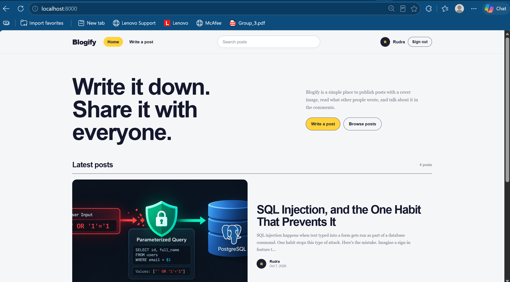
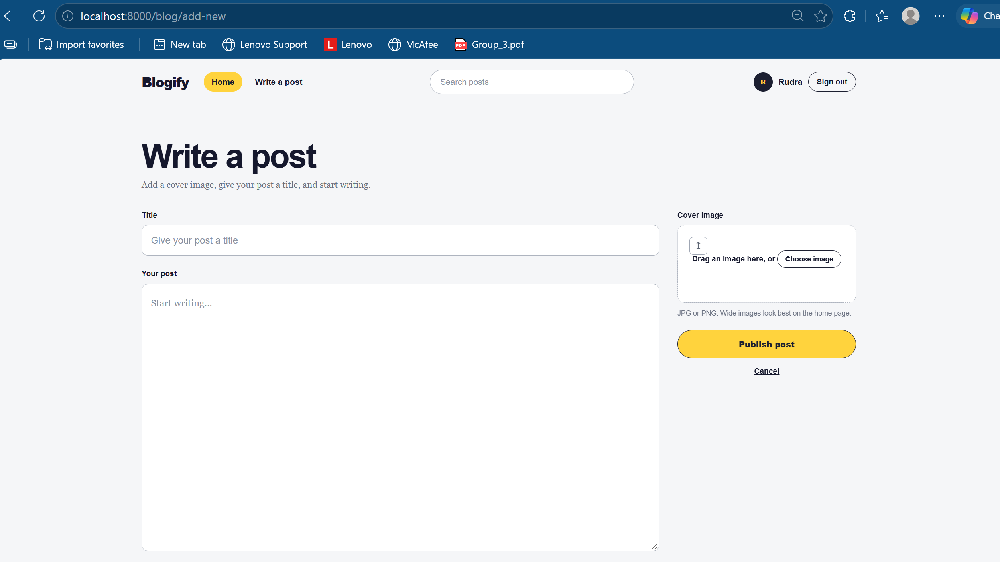
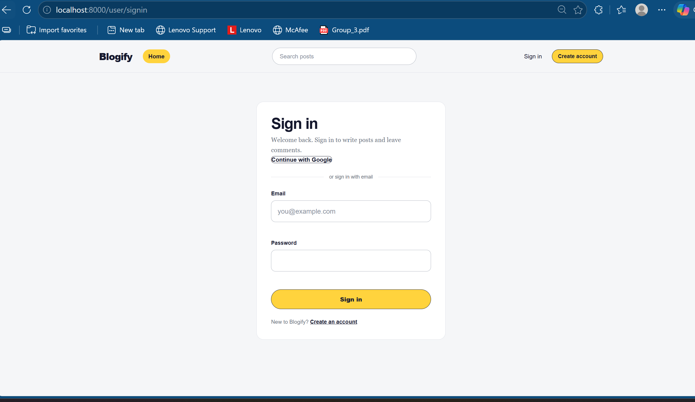
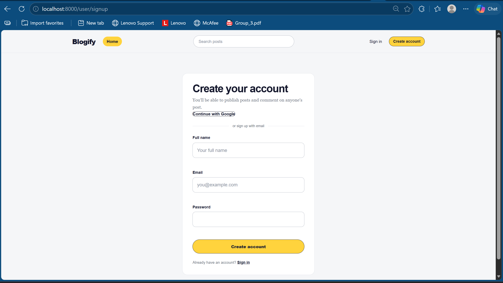
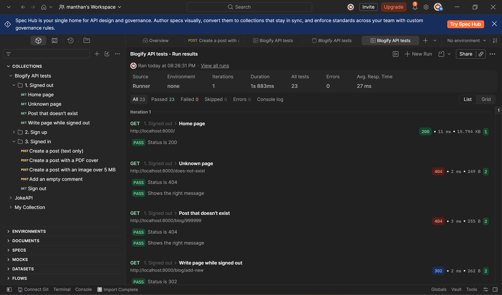

# Blogify

Blogify is a blogging website where users can sign up, write posts with a cover image, search posts, and comment on other people's posts.

I built it with **Node.js, Express, EJS and PostgreSQL**, and used **Passport.js** for login (email/password and Google).


---

## Screenshots

### Home Page



### Write a Post



### Sign In



### Create Account



---

## Features

- Sign up and sign in with email and password
- Sign in with Google
- Write a post with a title, text and a cover image (JPG or PNG, max 5 MB)
- Home page that shows the newest posts first
- Search posts by title, text or author name
- Comment on posts
- Only signed-in users can write posts and comments
- Works on desktop and mobile (custom CSS, no framework)

---

## Tech Stack

| Part | Technology |
|---|---|
| Backend | Node.js, Express |
| Frontend | EJS, HTML, CSS |
| Database | PostgreSQL |
| Login | Passport.js (Local + Google OAuth) |
| Password hashing | bcrypt |
| Sessions | express-session (sessions are saved in PostgreSQL) |
| File uploads | Multer |

---

## Folder Structure

```
├── index.js            # Starts the app (Express, sessions, Passport, home page)
├── db.js               # PostgreSQL connection
├── schema.sql          # Creates the database tables
├── test-db.mjs         # Tests the database connection
├── .env.example        # Example settings file
├── config/
│   └── passport.js     # Email/password and Google login
├── middlewares/
│   └── requireAuth.js  # Blocks pages if the user is not signed in
├── routes/
│   ├── user.js         # Sign up, sign in, sign out, Google login
│   └── blog.js         # Posts, comments, image uploads
├── views/              # EJS pages
└── public/
    ├── css/            # Styles
    ├── images/         # Default images
    └── uploads/        # Uploaded cover images
```

---

## Database

The app uses 3 tables (see `schema.sql`):

- **users** – name, email, password (hashed), profile picture, role
- **blogs** – title, text, cover image, and the user who wrote it
- **comments** – comment text, the post it belongs to, and the user who wrote it

A 4th table, **session**, is created automatically to store logged-in sessions.

---

## How to Run It Locally

### 1. Requirements

- Node.js (version 18.18 or newer)
- PostgreSQL

### 2. Install packages

```bash
git clone <your-repo-url>
cd <your-repo-folder>
npm install
```

### 3. Create the database

```bash
createdb blogify
psql -d blogify -f schema.sql
```

(Or in pgAdmin: create a database called `blogify` and run `schema.sql` in the Query Tool.)

### 4. Add your settings

Make a copy of `.env.example`, rename it to `.env`, and fill in your own values:

```
PG_USER=postgres
PG_PASSWORD=your_database_password
PG_HOST=localhost
PG_PORT=5432
PG_DATABASE=blogify
SESSION_SECRET=any_long_random_text
GOOGLE_CLIENT_ID=your_google_client_id
GOOGLE_CLIENT_SECRET=your_google_client_secret
GOOGLE_CALLBACK_URL=http://localhost:8000/user/auth/google/callback
NODE_ENV=development
```

For Google login, create an OAuth Client ID (Web application) in the [Google Cloud Console](https://console.cloud.google.com/) and add `http://localhost:8000/user/auth/google/callback` as a redirect URI.

> The `.env` file has passwords and secret keys, so it is in `.gitignore` and never uploaded to GitHub.

### 5. Test the database connection

```bash
node test-db.mjs
```

### 6. Start the app

```bash
node index.js
```

Open **http://localhost:8000** in your browser.

---

## Pages / Routes

| Page | URL | Login needed? |
|---|---|---|
| Home + search | `/` | No |
| Sign up | `/user/signup` | No |
| Sign in | `/user/signin` | No |
| Sign in with Google | `/user/auth/google` | No |
| Sign out | `/user/signout` | No |
| Write a post | `/blog/add-new` | Yes |
| View a post | `/blog/:id` | No |
| Add a comment | `/blog/comment/:blogId` | Yes |

---

## Security

- Passwords are hashed with **bcrypt**, never saved as plain text
- Login sessions are stored in the database, and the cookie is `httpOnly`
- All database queries use **parameterized queries** to prevent SQL injection
- EJS escapes user content to prevent XSS (scripts in posts show as plain text)
- Only JPG/PNG images up to 5 MB can be uploaded
- Secret keys are kept in `.env`, not in the code
- Users see simple error messages; full error details are only logged on the server

---

## Testing

I tested the app manually with these cases:

| Test | Expected result |
|---|---|
| Sign up with a new email | Account created and signed in |
| Sign up with a password under 8 characters | Error: "Password must be at least 8 characters." |
| Sign up with an email that already exists | Error: "An account with that email already exists." |
| Sign in with a wrong password | Stays on the sign-in page |
| Sign in with Google | Signed in (new account created on first use) |
| Open "Write a post" while signed out | Sent to the sign-in page |
| Upload a file that is not JPG/PNG | Error: "Only JPG and PNG images are allowed." |
| Upload an image over 5 MB | Error: "File is too large. Maximum size is 5 MB." |
| Post an empty comment | Error: "Comment cannot be empty." |
| Search for a word in a post title | Only matching posts show up |
| Open a page that doesn't exist | "Page not found." |

### API testing with Postman

I also tested the routes with **Postman** to check that the server sends back the right status codes and messages. The collection is in [`blogify.postman_collection.json`](blogify.postman_collection.json).

**Results:** all 23 checks passed.



| Request | Expected result |
|---|---|
| `GET /` | 200 |
| `GET /does-not-exist` | 404 "Page not found." |
| `GET /blog/999999` | 404 "Blog post not found." |
| `GET /blog/add-new` while signed out | 302 redirect to `/user/signin` |
| `POST /user/signup` with a short password | 400 "Password must be at least 8 characters." |
| `POST /user/signup` with a new email | 302 redirect to `/` (account created) |
| `POST /user/signup` with an email that already exists | 409 "An account with that email already exists." |
| `POST /blog` with title and text | 302 redirect to the new post |
| `POST /blog` with a PDF as the cover image | 400 "Only JPG and PNG images are allowed." |
| `POST /blog` with an image over 5 MB | 400 "File is too large. Maximum size is 5 MB." |
| `POST /blog/comment/:blogId` with an empty comment | 302 back to the post with an error |
| `GET /user/signout` | 302 redirect to `/` |

**How to run it:**

1. Start the app (`node index.js`).
2. In Postman, click **Import** and choose `blogify.postman_collection.json`.
3. In the two upload requests, pick a PDF file and an image larger than 5 MB in the `coverImage` field.
4. Run the collection in order. Postman keeps the login cookie between requests, so the "signed in" tests work after the sign-up test.

---

## Deployment

I am deploying this app on **AWS**. For production:

- `NODE_ENV` is set to `production` so cookies only work over HTTPS
- The Google callback URL is changed to the live website address
- The database runs on a PostgreSQL server (for example, Amazon RDS)

---

## Future Improvements

- Edit and delete posts and comments
- Show an error message when sign-in fails
- Store uploaded images on Amazon S3
- Add automated tests

---

## Author

**Manthan Jayswal**
[GitHub](https://github.com/Manthan420) | [LinkedIn](https://www.linkedin.com/in/manthan-jayswal09)